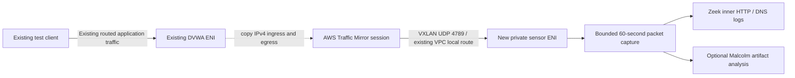

# Passive Malcolm / Zeek traffic-mirroring lab

**Capture foundation deployed on 2026-11-05; controlled Zeek HTTP/DNS acceptance passed.** This is a separate, disposable CloudFormation stack. It adds a private capture sensor to an existing workload subnet and can mirror one existing EC2 ENI after explicit enablement. It does not update the large FortiGate template, existing routes/security groups/instances, or XSIAM configuration. This is an optional lab experiment, not a dependency for the Friday demo.

## Why a separate stack

The existing `fed-cortex-demo-fortinet-2.yaml` manages the transit gateway, inspection VPC, FortiGate interfaces, three workload VPCs, EKS, databases, workloads, logging pipelines and automation. Its 68,485-byte deployed template matches the repository file apart from a local trailing newline. Extending it would couple this experiment's rollback and teardown to the live demo. It already exceeds CloudFormation's 51,200-byte inline template limit.

The new template accepts resource IDs as parameters. It creates no exports/imports and changes no routing. This avoids a deployment dependency on changing the original stack; the existing VPC, subnet and source ENI must nevertheless remain present until this experiment is removed. Existing stack automation filters on its own stack tag, so its Clap Off action will **not** stop this new sensor. A separate sensor shutdown timer is included.

This repository is public. Account-specific observed parameters, resource IDs and raw inventory are deliberately excluded. The local handoff includes `parameters.observed.json`; otherwise copy `parameters.example.json` to that filename and fill it from a fresh preflight.

## Architecture and observed fit



Read-only inspection on **2026-11-05** confirmed the main lab stack is `UPDATE_COMPLETE` in `us-east-2`. The selected DVWA source is a running `t3.micro`, with an ordinary attached ENI in the first workload VPC and `us-east-2a`. The deployed sensor uses the same subnet/AZ. Its subnet has an active VPC-local route and an active default route to the existing TGW. The subnet ACL allows IPv4 traffic in both directions, and the VPC uses AmazonProvidedDNS. Before deployment, no mirror sessions were returned by the complete `us-east-2` session listing. One experimental session has since been enabled. Existing SSM-managed hosts in this subnet were Online. The new sensor subsequently completed bootstrap and SSM readiness; see the deployment evidence below.

Same-subnet capture avoids sending mirrored packets through the TGW/FortiGate and avoids NLB/GWLB costs. Bootstrap and SSM still depend on the existing outbound inspection/NAT path. Do not change that path to make this experiment work before the demo. If bootstrap is blocked, leave mirroring disabled and stop/defer the experiment.

The source is **one workload ENI**, not an entire VPC tap. This captures that host's conversations, not all EKS, database, lateral, or FortiGate traffic. Start here instead of mirroring FortiGate's LAN and WAN simultaneously, which would create duplicated/pre-NAT/post-NAT observations and increase load on the critical inspection device. Expansion should be reviewed after the first test.

## What the template creates

- One `m6i.2xlarge` sensor: 8 vCPUs, 32 GiB RAM, encrypted 100-GiB gp3 root disk (parameter bounded to 100–200 GiB), Canonical Ubuntu 24.04 amd64.
- An explicit target ENI, dedicated security group, SSM instance role/profile, mirror target, IPv4 ingress/egress filter rules, and optional session. No public address, key pair, SSH ingress, or HTTPS ingress is configured.
- UDP 4789 ingress only from the source ENI's primary IPv4 `/32`. Outbound TCP 80/443 supports packages, images and SSM; DNS is limited to the VPC resolver. No forwarding/bridging or source/destination-check disabling is used.
- `NetworkServices: [amazon-dns]`, because ordinary mirror rules alone do not include Amazon-provided DNS. Full packets are requested by omitting `PacketLength`.
- An absolute stop deadline installed **before** bootstrap downloads (`ShutdownAtUtc`). The deployed backup is Friday, November 6, 2026 at 23:10 UTC (5:10 p.m. Central), with `Persistent=true`; reboot does not reset it. A stopped sensor still incurs EBS charges; existing mirror sessions still incur charges until deleted.
- A pinned Zeek 9.0.1 amd64 image and a root-only capture helper. It does not automatically install/start Malcolm, generate authentication, or forward anything to XSIAM.

The sizing meets Malcolm's documented minimum but is below its preferred 16+ CPU recommendation. It is intended for a small controlled capture, not production throughput. The EC2 image is amd64 on actual x86 EC2 hardware; the local Mac fixture test used the official **ARM64** Zeek image, with no Rosetta.

## Prerequisites and read-only preflight

1. Confirm account/region and review costs below. Deployment permission is separate from preparing this change.
2. Confirm the source belongs to the lab, is running, supports Traffic Mirroring, and has no conflicting session. The included preflight conservatively recognizes only the T3/C5 families reviewed for this lab.
3. Confirm the target subnet/VPC/AZ, DNS resolver, active local route and egress path. Recheck ACLs and quotas/capacity at deployment time; a listed instance-type offering does not guarantee capacity.
4. Confirm the selected AMI is available, Canonical-owned (`099720109477`), Ubuntu 24.04 amd64, with `/dev/sda1` root. The local observed parameter file pins the AMI checked during preparation; re-resolve if it is deregistered.
5. The deployment principal needs CloudFormation, EC2 mirroring/instance/network permissions, IAM role/profile creation and `iam:PassRole`; the sensor itself gets only `AmazonSSMManagedInstanceCore`. Administrator Session Manager access to captured content must remain limited to authorized lab operators.

The preflight uses the existing containerized AWS CLI and named authentication volume; it never prints credentials or deploys:

```sh
python3 preflight.py --expected-account YOUR_ACCOUNT_ID \
  --parameters parameters.observed.json --region us-east-2
```

It checks identity, source/subnet ownership and placement, DNS, AMI, routes and session conflicts. Its structured output lists remaining checks. Do not treat its success as a deployment or application health check. After a session exists it intentionally blocks; inspect ownership and priority rather than creating a duplicate.

## Deployment sequence (operator action, not executed during preparation)

Use the AWS CLI container to retain host isolation. From this directory:

```sh
aws_lab() {
  docker run --rm -e AWS_PAGER= \
    -v aws-fed-cortex-demo-auth:/root/.aws \
    -v "$PWD":/work:ro public.ecr.aws/aws-cli/aws-cli:latest \
    "$@" --profile fed-cortex-demo --region us-east-2
}
```

First create a **change set only**, with `EnableMirroring=false` in the reviewed parameter file:

```sh
aws_lab cloudformation create-change-set \
  --stack-name fed-cortex-demo-mirror-lab \
  --change-set-name sensor-review --change-set-type CREATE \
  --template-body file:///work/sensor.template.json \
  --parameters file:///work/parameters.observed.json --capabilities CAPABILITY_IAM
aws_lab cloudformation wait change-set-create-complete \
  --stack-name fed-cortex-demo-mirror-lab --change-set-name sensor-review
aws_lab cloudformation describe-change-set \
  --stack-name fed-cortex-demo-mirror-lab --change-set-name sensor-review
```

Expected: additions owned by the new stack; no existing-stack updates, replacements or mirror session. Review AWS validation events/permissions and costs before executing. Only after deployment approval:

```sh
aws_lab cloudformation execute-change-set \
  --stack-name fed-cortex-demo-mirror-lab --change-set-name sensor-review
aws_lab cloudformation wait stack-create-complete --stack-name fed-cortex-demo-mirror-lab
aws_lab cloudformation describe-stacks --stack-name fed-cortex-demo-mirror-lab \
  --query 'Stacks[0].Outputs'
```

**CREATE_COMPLETE means infrastructure provisioned, not bootstrap or Malcolm ready.** No success signal is claimed. Connect to the new sensor through the AWS Systems Manager console and check:

```sh
sudo cloud-init status --wait
sudo test -f /var/lib/mirror-lab/BOOTSTRAP_READY
sudo test ! -f /var/lib/mirror-lab/BOOTSTRAP_FAILED
sudo tail -n 50 /var/log/mirror-lab-bootstrap.log
sudo systemctl status mirror-lab-stop.timer --no-pager
sudo docker run --rm --network none \
  zeek/zeek@sha256:71c1d6b61cdcc25d306c091d32b3da15583485c0c9dfc45cdff48b088cdfdc92 zeek --version
ip -br link
```

Check sensor private IP/no public IP in EC2, SSM Online, and adequate sensor-interface MTU. Small 1500-byte-or-less source packets need room for the additional VXLAN headers. Do not change source MTU/offloads for this test. Full jumbo traffic may be truncated even with `PacketLength` omitted; examine capture loss and packet lengths.

If bootstrap fails, preserve the error, leave mirroring disabled and delete the experimental stack when finished. No main-lab remediation is part of this plan.

After readiness, make a copy of the reviewed parameter file with only `EnableMirroring` changed to `true`. Create an UPDATE change set using that file, review that the only resource addition is the session, then execute it. The source ENI now incurs mirrored bandwidth and per-session charges. Do not execute this enable step during an important demo without a separate agreed test window.

## Capture and acceptance

In the new sensor's SSM session:

```sh
sudo /usr/local/sbin/mirror-capture-test
```

This selects the interface on the source's local route, captures only outer UDP 4789, runs for 60 seconds and rotates through four approximately 100-MB files. Each run has a new root-only directory. **Repeated runs accumulate directories**; retain only the needed test and remove superseded captures. It is a bounded test, not an unattended recorder. Review tcpdump packet/drop counts.

The verified HTTP test uses an outbound request from the mirrored host: `curl --max-time 8 http://example.com/mirror-UNIQUE_MARKER`. A 404 for that marker still validates request/response decoding. The original inbound cross-VPC path remains unverified. During that minute, optionally issue a benign HTTP request to the existing DVWA host from an existing permitted test client (`curl --max-time 5 'http://SOURCE_PRIVATE_IP/?mirror-demo=UNIQUE_MARKER'`). On the mirrored host, an uncached DNS lookup such as `getent ahostsv4 mirror-UNIQUE_MARKER.example.com` exercises its configured resolver; NXDOMAIN is an acceptable expected response. Use existing tools only. No exploits, scans, attacks, model changes or source-host package installs are required. These commands were not executed during initial preparation; live test results are tracked separately.

Analyze a completed PCAP on the sensor (replace paths with the actual closed file; the ring names end in a digit):

```sh
sudo mkdir -m 0700 /var/lib/mirror-lab/zeek-test
sudo docker run --rm --network none --cap-drop ALL --security-opt no-new-privileges \
  --read-only -v /var/lib/mirror-lab/capture/TEST/mirror.pcap0:/input.pcap:ro \
  -v /var/lib/mirror-lab/zeek-test:/out -w /out \
  zeek/zeek@sha256:71c1d6b61cdcc25d306c091d32b3da15583485c0c9dfc45cdff48b088cdfdc92 \
  zeek -C -r /input.pcap LogAscii::use_json=T
```

Zeek's built-in VXLAN analyzer decapsulates UDP 4789; no kernel VXLAN bridge is created. `-C` ignores checksum validation for capture/offload compatibility. It does not repair missing/truncated packets. For the first test keep traffic low enough that the connection stays within one ring file; splitting a flow across separately processed files can produce incomplete records.

Pass criteria:

1. Expected source-to-sensor UDP 4789 arrives and tcpdump shows no observed kernel drops in this small test.
2. `http.log` shows **inner client/server IPs**, requested marker URI and the application response (e.g. 200/302), not merely the outer tunnel endpoints.
3. `dns.log` shows the mirrored host, expected resolver, exact test query and response/rcode. A DNS lookup made only on an unmirrored host is not a valid test.
4. `conn.log` links inner sessions to a VXLAN tunnel parent. Compare timestamps and tuples with the deliberate requests. TLS remains encrypted; mirroring does not decrypt HTTPS or export FortiGate's decrypted inspection stream.
5. If Malcolm is configured, import the small PCAP and verify its Zeek HTTP/DNS views display the inner records. Outer VXLAN visibility alone is insufficient. Malcolm/Arkime UI behavior has not been tested by this preparation.
6. Disable/delete the mirror session at the end of the approved runtime (Friday after 5 p.m. Central for this run). Existing lab traffic should continue as before; do not change its routes or model rules to address capture gaps.

## Optional Malcolm installation

The base stack is a working capture/Zeek foundation, **not an unattended Malcolm installation**. Keeping interactive Malcolm configuration separate avoids generating credentials or exposing a UI before operator review.

After base acceptance, use the verified download helper on the new sensor as `ubuntu`. It pins official release **26.10.0** and verifies the release asset SHA-256 before extraction. It downloads only. Review and run the extracted `install.py` following [Malcolm's AWS instructions](https://malcolm.fyi/docs/aws.html) and [configuration guide](https://malcolm.fyi/docs/malcolm-config.html). Select local artifact analysis, keep external forwarding and live capture off for the first test, configure disk/index retention within the 100-GiB disk, and pull the pinned release's images. Let the operator perform `auth_setup` privately; do not place credentials in UserData, CloudFormation parameters, logs or Git.

Follow the installer reboot instruction; reconnect by SSM, start Malcolm and verify `scripts/status` plus the authenticated UI. Reach HTTPS through Session Manager port forwarding to the new instance's port 443, for example with `AWS-StartPortForwardingSession` local port 8443. This requires the Session Manager client/plugin on the operator workstation or another approved access method; do not open the sensor security group to work around missing tooling. No host plugin was installed by this work. No HTTPS ingress rule is needed for an SSM tunnel.

This stage has not been runtime-tested. Registry access, TLS inspection trust, local OpenSearch initialization, authentication and available disk may still block it. A Zeek PCAP result remains useful if the larger Malcolm UI is deferred. Zeek output is not automatically Corelight output, and neither this stack nor Malcolm setup configures XSIAM ingestion or validates its content pack/model rules.

## Cost and teardown

Observed Ohio public on-demand rates on 2026-11-05: `m6i.2xlarge` Linux shared **$0.384/hour** (AWS Pricing API); gp3 storage **$0.08/GB-month** at baseline IOPS/throughput (AWS Pricing API); mirroring **$0.015/session-hour** ([AWS VPC pricing](https://aws.amazon.com/vpc/pricing/)).

For one sensor, 100 GiB and one session, excluding transfer/other charges:

| Lifetime, if all new resources are removed at the end | Estimated incremental cost |
|---|---:|
| Four hours | about **$1.64** |
| 24 hours continuously running | about **$9.84** |
| 730 hours continuously running | about **$299.27** |

These are estimates, not a spend cap or quote. Regional transfer, existing TGW/NAT/inspection-path processing for downloads, downloads/egress, taxes and optional exports/snapshots are additional. Same-AZ local mirroring avoids intentionally introducing cross-AZ/TGW mirror transport, but no blanket zero-network-charge promise is made. Malcolm image downloads can be substantial. No new NAT gateway, NLB, public IPv4 or VPC endpoint is provisioned. The absolute backup timer stops the sensor; it does **not** delete sessions or EBS or provide a billing kill switch. AWS EventBridge Scheduler independently initiates stack deletion after the approved runtime.

Teardown order:

1. Change `EnableMirroring` to `false` through a reviewed UPDATE change set, execute it and wait for completion. Confirm `MirrorSessionId` is `disabled` and no session remains on the source ENI. This stops session charges; merely stopping the source or sensor does not.
2. Export only deliberately selected, sanitized evidence if needed. PCAPs can contain payloads and credentials from this intentionally vulnerable lab. No automatic S3 export is configured.
3. Delete **only** `fed-cortex-demo-mirror-lab` and wait for `stack-delete-complete`. The new sensor, encrypted root disk/captures, target, filter/rules, ENI, group and instance role/profile are deleted. There are no retention snapshots or buckets. Existing lab resources are not stack-owned here.
4. Verify the new instance is terminated, its root volume and target ENI are gone, and no session references the source. Inspect and resolve `DELETE_FAILED` rather than assuming costs stopped. Do not delete or update the original lab stack.

## Validation evidence and limits

See [VALIDATION.md](VALIDATION.md). Local parser/guard/shell checks, AWS `validate-template`, read-only preflight, and an actual offline Zeek VXLAN fixture are separate layers. None proves live packet delivery or Malcolm startup. That statement described initial preparation only. The authorized sensor and mirror session are now deployed; tenant configuration remains unchanged. Controlled live HTTP/DNS capture acceptance passed; the cross-VPC inbound path and full Malcolm UI remain unverified.

## References

- [AWS Traffic Mirroring overview and supported source families](https://docs.aws.amazon.com/vpc/latest/mirroring/what-is-traffic-mirroring.html)
- [Target routing, VXLAN and security groups](https://docs.aws.amazon.com/vpc/latest/mirroring/traffic-mirroring-targets.html)
- [Limitations, MTU and bandwidth](https://docs.aws.amazon.com/vpc/latest/mirroring/traffic-mirroring-network-limitations.html)
- [CloudFormation mirror filter / Amazon DNS](https://docs.aws.amazon.com/AWSCloudFormation/latest/TemplateReference/aws-resource-ec2-trafficmirrorfilter.html)
- [CloudFormation mirror session / full packets](https://docs.aws.amazon.com/AWSCloudFormation/latest/TemplateReference/aws-resource-ec2-trafficmirrorsession.html)
- [Zeek VXLAN analyzer](https://docs.zeek.org/en/current/scripts/base/packet-protocols/vxlan/main.zeek.html)
- [Official Zeek container](https://hub.docker.com/r/zeek/zeek)
- [Malcolm AWS deployment](https://malcolm.fyi/docs/aws.html), [official pinned release](https://github.com/cisagov/Malcolm/releases/tag/v26.10.0)

## Deployed runtime and cleanup verification (2026-11-05)

Both the capture stack and separate cleanup controller report `UPDATE_COMPLETE`. The sensor has its bootstrap-ready marker, Docker active, Zeek 9.0.1 available, and capture-interface MTU 9001. HTTPS bootstrap required the existing lab inspection public CA, verified against an existing host's trust store and installed only on this new sensor. TLS and package integrity verification remain enabled. No original lab configuration was changed.

The old one-to-eight-hour uptime parameter has been removed. The active AWS schedule is `at(2026-11-06T17:05:00)` in `America/Chicago`, enabled with its flexible window off. It targets the exact experimental stack ARN for deletion. The sensor independently reports its next systemd stop at `2026-11-06 23:10:00 UTC` (Friday 5:10 p.m. Central). These allow the approved run through 5 p.m.; neither stops it early.

The cleanup execution role allows deletion only of enumerated experiment-owned resources and includes the actual mirror session. A separate non-compute canary stack was successfully deleted by that scheduler role; CloudTrail verified the caller. Instance termination and mirror-session/target deletion authorization are additionally checked by IAM simulation, not by deleting the active experiment. A 5:20 p.m. Central follow-up is scheduled to verify deletion and remove the cleanup controller. Future agent access is not guaranteed; the primary AWS schedule operates independently.

The approved incremental ceiling is $30. Approximately 44.5 hours at the verified instance, 100-GiB storage and one-session rates projects about $18.3 before transfer and other charges. This is an estimate, not an AWS-enforced spending cap. Stopping an instance leaves storage and mirror-session charges; verify actual stack/resource deletion and inspect the scheduler dead-letter queue on any failure. No changes are planned after Friday 9 a.m. Central.

The sensor captures only when its bounded test helper is invoked; this is not continuous recording or a running Malcolm UI. Preserve native Zeek JSON. CEF/syslog and JSON/Kafka remain future Broker transport options; neither forwarding nor XDM changes have been configured.

### Live acceptance outcome

Systemd-managed capture stopped after exactly 60 seconds with 115 packets and zero kernel drops. Zeek recovered the deliberate DNS marker and outbound HTTP marker, including the matching HTTP 404 response and inner endpoints. The helper now uses the service manager for lifecycle while retaining AppArmor enforcement. The initial direct `timeout` from snap SSM was blocked by AppArmor; that failed run was ended by rebooting only the sensor. See [VALIDATION.md](VALIDATION.md) for timestamps, observed responses and limitations.

The cross-VPC HTTP request still timed out, although DVWA returns 302 locally. Its expected tuple was not present in the controlled capture; the blocking point is unconfirmed. No original lab configuration was changed to repair it. This is a successful controlled outbound HTTP/DNS capture test, not full Malcolm UI, continuous recording, or Broker ingestion acceptance.

### Full Malcolm is configured, not running

The pinned 26.10.0 application is staged at `/home/ubuntu/Malcolm`. Its configuration-only step and `docker compose --profile malcolm config --quiet` passed at 03:16 UTC on November 5. The initial automatic approval rejection was resolved by read-only source evidence: this path copies credential placeholders and does not generate credentials, run `auth_setup`, or start containers. The exact operation was retried once and succeeded.

Verified settings: UI bind `127.0.0.1:443:443/tcp`; basic authentication selected; Malcolm live capture and interface tweaks disabled. No Malcolm containers or HTTPS listener are running, and administrator password/TLS-key artifacts do not exist. User-controlled authentication, image pulls, host prerequisites and full application health/UI/PCAP validation remain pending. After explicit approval, Docker access for `ubuntu` was enabled and verified, and `apache2-utils` installed the required `htpasswd` utility. Administrator authentication remains a private user step. No Broker forwarding was configured. Standalone Zeek acceptance is not full Malcolm readiness.
